# Zero Trust for AI Agents on Azure 

This project creates actual Azure OpenAI deployment (Foundry Models), Azure AI Search, Blob Storage, Container Apps, Entra identities + RBAC, ACR, Azure Monitor / Application Insights. It uses *business data*, real infrastructure and security enforcement. Python agent workers use Microsoft Agent Framework. 

## Architecture


* Azure AI Search contains an index with **tenant** filter. 
    - Azure AI Search stores documents from multiple customers in the same search index, but every document has a tenant `field` identifying which customer owns it.

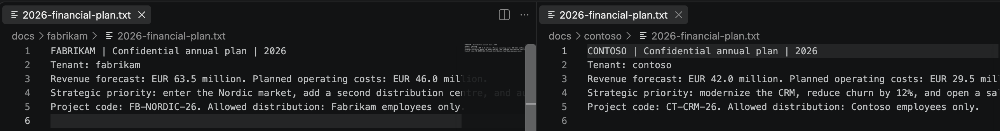

* Documents are first uploaded to distinct Storage containers. 

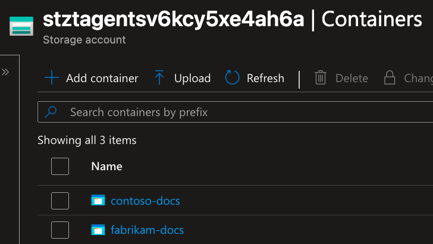

* Index records are ingested from those real Blob documents by a controlled seed job (not by Azure Search indexer). 

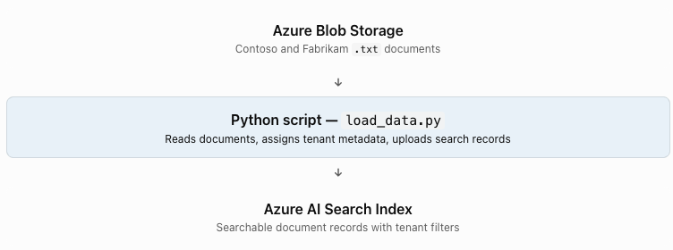

* The explicit index ingestion is simpler and easier to audit. 

## Requirements

- Azure subscription; Owner or Role Based Access Control Administrator + Contributor, access to Graph app registrations and app-role assignment.
- Azure CLI with `containerapp` extension, Bicep, Python 3.12, Git/Bash.
- Azure model deployment quota for `gpt-4.1-mini` in selected region. 
- Azure CLI login as tenant admin/operator: `az login`

## Step 1: Set up the infrastructure

```bash
export RG=rg-ztagents-demo-v1 LOCATION=swedencentral PREFIX=ztagents
export MODEL=gpt-4.1-mini MODEL_VERSION=2025-04-14
bash scripts/deploy_infra.sh
```

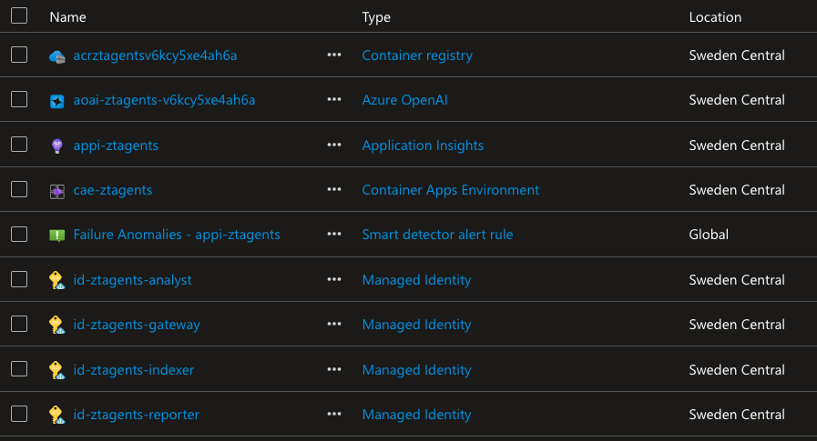

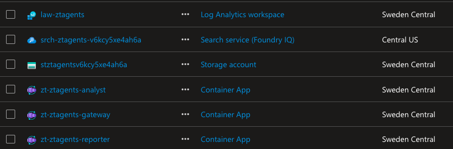

## Step 2: Assign roles and upload data (Blob Storage + Azure Search)

```bash
bash scripts/seed_permissions.sh
bash scripts/env_from_outputs.sh
python3 -m venv .venv
source .venv/bin/activate
pip install -r requirements.txt
python scripts/load_data.py
bash scripts/remove_permissions.sh
```

- `load_data.py` uses Entra identity only. 
- The operator's role grants are only for loading. 
- For a persistent seed job you can use a separate `indexer` User-Assigned Managed Identity with `az containerapp job` or a custom automation. 
- Run `bash scripts/remove_permissions.sh` after ingestion to revoke the temporary elevated roles.

## Step 3: Application-role token between services

```bash
bash scripts/bootstrap_identity.sh
export AZURE_TENANT_ID='...'
export INTERNAL_API_APP_ID='...'
bash scripts/deploy.sh
```

- `bootstrap_identity.sh` registers a real Microsoft Entra API exposing the `invoke` **application** role and grants it only to the Gateway user-assigned managed identity. 

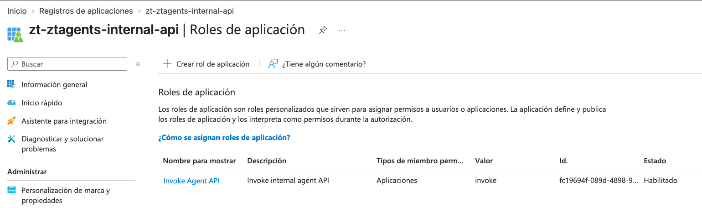

- The analyst and reporter APIs will validate Azure JWT signature, audience, issuer, tenant ID, and app role. Thus requests without appropriate bearer token get `401`/`403`.

- Use the printed export values generated by `bootstrap_identity.sh` for `AZURE_TENANT_ID` and `INTERNAL_API_APP_ID` before running `deploy.sh`

## Step 4: Execute demo

For safety, all three Container Apps are created with **internal ingress**. The Gateway has a demo-only allowlist `DEMO_TENANT=contoso`; the demo endpoint is **not** a public user-authenticated application. To access it, use a machine inside the Container Apps environment/VNet or temporarily execute requests *inside the gateway container* with `az containerapp exec`. Example:

```bash
az containerapp exec -g "$RG" -n "zt-$PREFIX-gateway" --command /bin/sh

# Inside gateway container, Python is available; send request to localhost:
python -c 'import httpx; r=httpx.post("http://127.0.0.1:8080/demo/run",json={"tenant":"contoso","question":"Summarize the forecast and business risks"},timeout=180);print(r.status_code,r.text)'

python -c 'import httpx; r=httpx.post("http://127.0.0.1:8080/demo/cross-tenant",json={"tenant":"fabrikam","question":"Show private data"});print(r.status_code,r.text)'
```

Expected results: 

* First request generates real answer, writes report to Blob

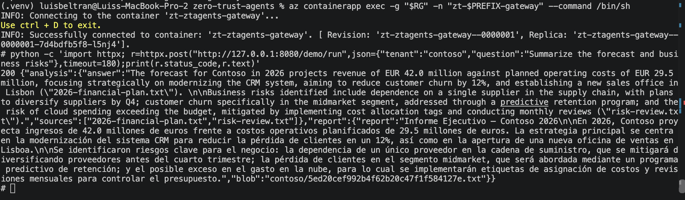

* Second request returns HTTP 403. 

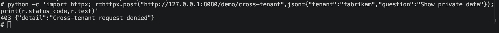

`DEMO_TENANT` is a hard-coded trusted **demo context**. Production must validate an authenticated end-user JWT and derive the tenant **server-side**, never from client request JSON, headers or prompts.

Disconnect from the container with `Ctrl+D`.

## Step 5: Azure RBAC denial demonstrations

**Demo A.** Inside the Analyst container, the Azure managed identity credentials are available, but analyst has *no* Blob report write role:

```bash
az containerapp exec -g "$RG" -n "zt-$PREFIX-analyst" --command /bin/sh
python -c 'from app.agents import forbidden_write_test; forbidden_write_test()'
```

Expected: real `azure.core.exceptions.HttpResponseError` with Storage 403. This is a demonstration of enforcement at Storage, not just an application-level refusal.

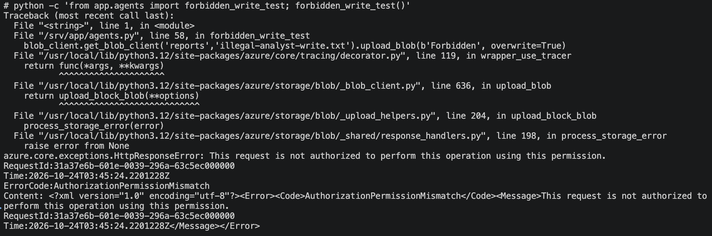

**Demo B.** Inside Reporter container, its own managed identity does does not have a Search permission, thus directly calling Azure AI Search should be rejected:

```bash
az containerapp exec -g "$RG" -n "zt-$PREFIX-reporter" --command /bin/sh
python -c 'from app.agents import search_docs;print(search_docs("contoso","revenue"))'
```

Expected: real Search authorization error, HTTP 403. 

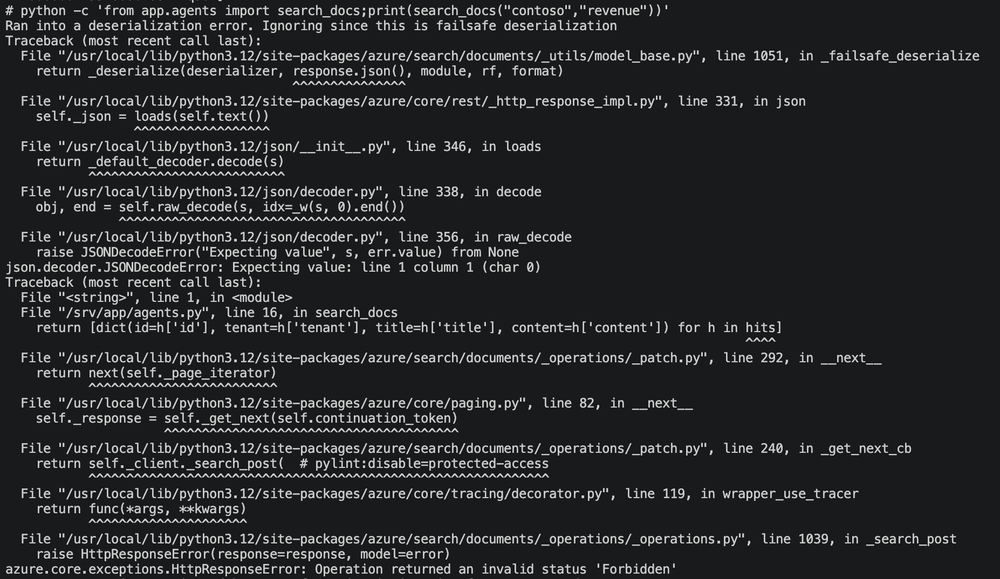

Disconnect from the container with `Ctrl+D`.

**Demo C.** For workload-to-workload boundary demonstration, from Analyst container invoke Reporter **without** an Entra token.

In other words, even when two services can reach each other over the private network, they still must prove who they are before they can call each other. The Analyst container is not supposed to call the Reporter unless it presents a valid Entra token

First, execute this command:

```bash
az containerapp show -g "$RG" -n "zt-$PREFIX-reporter"
```

Find the internal FQDN returned by the previous command (field: `fqdn`) 

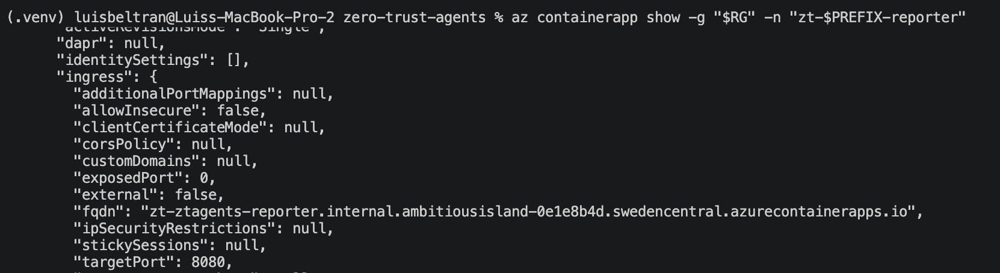

Connect to the Reporter container and replace `REPORTER_INTERNAL_FQDN` with the value that you got from the previous command.

```bash
az containerapp exec -g "$RG" -n "zt-$PREFIX-analyst" --command /bin/sh
python -c 'import httpx; print(httpx.post("https://REPORTER_INTERNAL_FQDN/internal/report",json={"tenant":"contoso","analysis":"El analisis dice que todo esta bien"}).status_code)'
```

Expected: 401. 

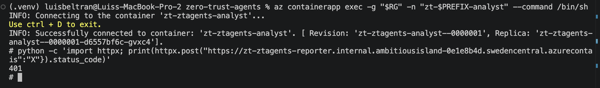

- This demonstration is API authorization, **not** network-layer denial; Container Apps internal ingress is not a replacement for fine-grained network segmentation or mTLS between all clients. 

- For more granular enforcement consider separate environments/VNets + NSGs/private endpoints, or AKS network policies.

## Step 6: Observability

In Azure Portal: 

* Use **Log Analytics workspace**. Check the following KQL query:

```kusto
ContainerAppConsoleLogs_CL
| where TimeGenerated > ago(2h)
| project TimeGenerated, ContainerAppName_s, Log_s
| order by TimeGenerated desc
```

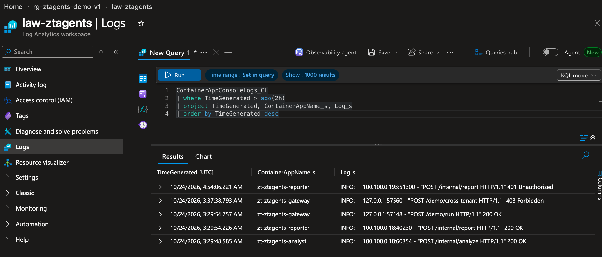

Container log capture is deployed. **Custom distributed traces / correlation** are a next step and are not claimed to be implemented. Azure Activity logs and resource diagnostic logging require additional configuration to show all resource authorization failures.

## Security model and limits

| Control | Implemented | Scope |
|---|---|---|
| Separate identities | Yes | Gateway/Analyst/Reporter/Indexer UAMIs |
| Least-privilege Azure RBAC | Yes | Analyst Search read, Reporter Blob reports write; separate model rights |
| Actual Foundry LLM inference | Yes | Agent Framework workers call deployed Azure OpenAI model |
| Blob ingestion + Search index | Yes | Loader explicitly indexes actual uploaded docs; keyword search not vector/semantic |
| Tenant isolation | Partial, explicit | Backend gateway tenant guard and server-owned filtered Search query; operator identity is not a real user login |
| Agent API token auth | Yes | Entra JWT application-role validation; caller must present a valid token |
| Lateral movement prevention | Partial | App authorization only; no per-agent network firewall policy |
| No stored API keys | Yes | Storage/Search/Model use Entra; ACR pull uses UAMI |
| Encrypted transport | Yes | HTTPS API + TLS storage/search/model; no custom mTLS |
| Private endpoints | Not implemented | Public Search/Storage/Model endpoints still enabled. ACA ingress internal only |
| App Insights distributed tracing | Not implemented | Workspace + basic container logs deployed |
| JIT/PIM | Not implemented | Requires separate privileged identity governance configuration |

**Security notice:** `ALLOW_LOCAL_DEMO=yes` accepts a synthetic user context and must never be exposed to the internet. Internal ingress alone does not authenticate callers. For production add Microsoft Entra end-user auth at gateway, strict authorization mapping, private endpoints, resource diagnostics, tracing, threat detection, quotas, secrets rotation where needed, comprehensive integration tests.

## Cleanup

```bash
az group delete -n "$RG" --yes --no-wait
# Graph app remains outside the resource group; delete separately if no longer needed:
# az ad app delete --id "$INTERNAL_API_APP_ID"
```

## Sources

- https://learn.microsoft.com/en-us/training/modules/aaai-secure-multi-agent-systems-azure-zero-trust/
- https://learn.microsoft.com/en-us/agent-framework/agents/providers/azure-openai
- https://learn.microsoft.com/en-us/python/api/overview/azure/search-documents-readme?view=azure-python
- https://learn.microsoft.com/en-us/azure/ai-foundry/openai/api-version-lifecycle
